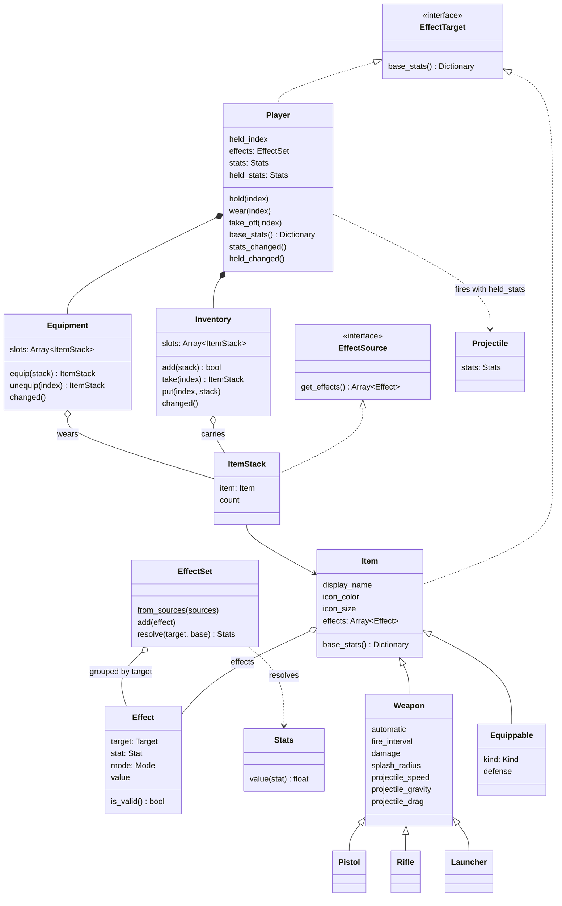
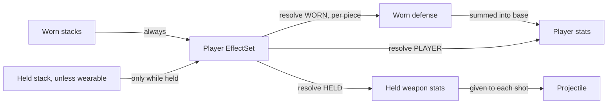

# trr

A small Terraria-like 2D game made with Godot 4.

## Inventory, equipment and effects

The player owns an `Inventory` of `ItemStack`s, the copies of items it carries. The first inventory row is the hotbar, and the player holds one of those slots (keys `1`–`0`). Wearing an equippable (right mouse button on the held slot) moves its stack from the inventory into `Equipment`, and whatever it replaces takes its inventory slot. Clicking a worn piece in the equipment panel moves it back to the first free inventory slot.

Effects are built around two contracts. GDScript has no interfaces, so they are duck-typed methods:

- **Effect source**: anything with `get_effects() -> Array[Effect]`. Item stacks are sources today; buffs or ammo can be added later without touching the targets.
- **Effect target**: anything with `base_stats() -> Dictionary`. A target resolves its final `Stats` with `effects.resolve(target, base_stats())`.

- **Items** are Resources (`.tres`) shared by every copy: weapons live in `items/`, equipment in `equipment/`. Anything that differs per copy belongs on `ItemStack`.
- **Equippable** items declare a `kind` (`HEAD`, `BODY`, `LEGS`, `ACCESSORY`) and a base `defense`, and `Equipment` only puts them in a matching slot.
- **Effects** change one `Stat` by a `FLAT` amount or a `PERCENT` of the base, on one `Target`:

  | Target | Applies to | Stats |
  |---|---|---|
  | `PLAYER` | The player | `SPEED` (walking), `DEFENSE` |
  | `WORN` | Each worn piece | `DEFENSE` |
  | `HELD` | The held item and the shots it fires | `FIRE_RATE`, `SPEED` (projectile), `DAMAGE`, `SPLASH_RADIUS`, `GRAVITY` |

- **Resolving**: final values are `(base + flat) * (1 + percent)`. The player resolves each worn piece's defense first, sums it into its own base, then resolves its `PLAYER` stats and the held weapon's `HELD` stats. Each projectile keeps the held stats from the moment it was fired.
- **Validation**: an effect whose stat isn't listed for its target is ignored with a warning, once per effect. A valid effect whose target lacks the stat right now (a damage bonus while holding boots) is skipped silently.
- **When**: the player rebuilds its `EffectSet` whenever the inventory, equipment or held slot changes. Equipment effects apply only while worn, never while merely held; other items' effects apply only while held.
