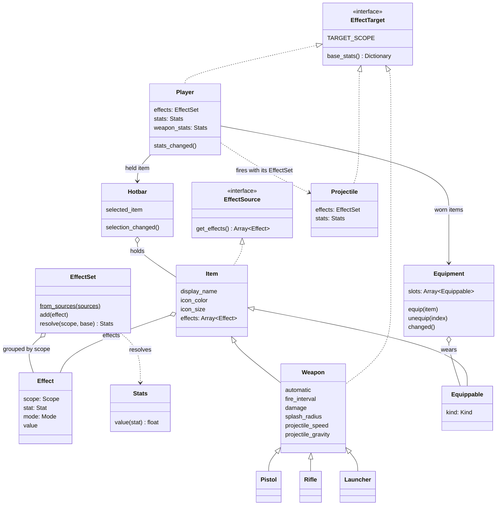
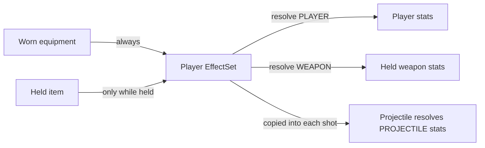

# trr

A small Terraria-like 2D game made with Godot 4.

## Items, equipment and effects

Effects are built around two contracts. GDScript has no interfaces, so they are duck-typed methods:

- **Effect source**: anything with `get_effects() -> Array[Effect]`. Items are sources today; buffs or ammo can be added later without touching the targets.
- **Effect target**: anything with a `TARGET_SCOPE` constant and `base_stats() -> Dictionary`. A target resolves its own final `Stats` with `effects.resolve(TARGET_SCOPE, base_stats())`.

- **Items** are Resources (`.tres`): weapons live in `items/`, equipment in `equipment/`.
- **Equippable** items declare a `kind` (`HEAD`, `BODY`, `LEGS`, `ACCESSORY`), and `Equipment` only puts them in a matching slot.
- **Effects** change one `Stat` by a `FLAT` amount or a `PERCENT` of the base, on one `Scope`. Each target declares which stats it has:

  | Scope | Target | Stats |
  |---|---|---|
  | `PLAYER` | The player | `SPEED` (walking), `DEFENSE` |
  | `WEAPON` | The held weapon | `FIRE_RATE` |
  | `PROJECTILE` | Each shot fired | `SPEED`, `DAMAGE`, `SPLASH_RADIUS`, `GRAVITY` |

- **Resolving**: final values are `(base + flat) * (1 + percent)`. An effect on a stat its target doesn't have is skipped with a warning.
- **The player** rebuilds its `EffectSet` whenever equipment or the hotbar selection changes, then resolves its own stats and the held weapon's. Each projectile gets the set that was active when it was fired and resolves its own stats. Equipment effects apply all the time; a weapon's own effects apply only while it is held.
